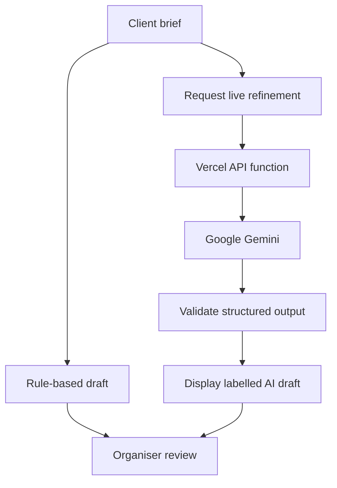

<div align="center">

# UtsavOps
### Dream it beautifully. Deliver it together.

**An event organiser studio that connects the client brief, creative direction, money and people—through decisions a human approves.**

[](https://utsav-event-studio.vercel.app/)
[](#the-challenge)
[](#where-generative-ai-fits)

**[Try the app](https://utsav-event-studio.vercel.app/) · [Explore the workflow](#one-order-five-connected-steps) · [Run locally](#run-the-interface-locally) · [Understand the boundaries](#prototype-boundaries)**

</div>

---

## A guest-count change is never just a seating change

A client adds 60 guests. Catering estimates change. The budget tightens. The organiser needs to confirm capacity, service arrangements and supplier availability before the team changes its plan.

UtsavOps brings these connected records into one workspace. The organiser can **preview an impact, review the assumptions, approve a change and retain a history of the decision**.

Built for professional organisers coordinating weddings, birthdays and community celebrations. Humans remain responsible for supplier confirmation, client decisions and work on the ground.

> **The product idea:** AI helps shape the experience. Deterministic code handles the arithmetic. People own the decisions.

## The challenge

**Virtual PromptWars · Challenge 5: Celebration & Event Planner**  
Created by **Vuppu Adithya Kumar**, with ChatGPT/Codex assistance during design, development and testing.

The prototype focuses on the organiser's operational workflow: translating a client's vision into a plan, coordinating responsibilities and responding to change with visible consequences.

## One order, five connected steps

| Step | What the organiser does | What stays connected |
| :--- | :--- | :--- |
| **01 · Client brief** | Capture the occasion, venue context, budget, guests and priorities. | The constraints behind the plan. |
| **02 · Creative plan** | Review a context-based draft; request live Gemini refinement. | Theme, activities, food ideas and clarification questions. |
| **03 · Budget & vendors** | Edit allocations, supplier records, quote status and recorded payments. | Estimates, commitments and contingency. |
| **04 · Team & schedule** | Assign task owners, timing, dependencies and progress. | Responsibilities, prerequisite checks and overlap warnings. |
| **05 · Review & delivery** | Preview changes, approve or reject proposals, review history and export. | The working plan and its decision trail. |

### Small details that make the workflow usable

- **Order pipeline:** search, filter and record Enquiry → Confirmed → Planning → Live → Completed.
- **Guided onboarding:** a five-lesson tutorial, contextual help and a feature guide.
- **Organiser profile:** name, company, city and specialty.
- **Personalised planning:** occasion, style, setting, guest count and priorities influence the initial draft.
- **Appearance controls:** indigo, lavender and coral; light/dark themes and app brightness.
- **Plan portability:** JSON export, print view and unsaved-change warnings.

## Where generative AI fits

The app has two deliberately labelled sources of creative content:

| Source | When it runs | Output |
| :--- | :--- | :--- |
| **Rule-based planning** | When an event plan is created. | An immediate context-based draft; explicitly labelled as not live AI. |
| **Live Google Gemini** | When the organiser clicks **Refine with live AI**. | A personalised theme, vision, three activity ideas, three food/beverage ideas and three clarification questions. |

The live path is wired through [`api/plan.mjs`](api/plan.mjs). The default model in the current source is `gemini-3.5-flash-lite`; `GEMINI_MODEL` can override it server-side.



**What the integration does:**

- Keeps `GEMINI_API_KEY` on the server, outside the browser bundle.
- Sends a reduced brief: event type, city, guests, budget, preferences and selected creative context. The endpoint does not forward the client's name or venue field.
- Requests structured JSON and validates the response before displaying it.
- Treats the brief as data and asks the model not to invent bookings, confirmed prices or completed actions.
- Uses bounded requests and one automatic retry for transient upstream failures.
- Returns explicit errors without replacing the existing plan with fabricated AI output.

> [!NOTE]
> A successful live-refinement notification has been observed in the app. This is evidence of a working generation path, not a promise of continuous provider availability. Timeouts, quota errors and upstream service failures can still occur.

## A change you can inspect before applying

**Example:** 200 → 260 guests, with a recorded variable catering rate of **₹800 per guest**.

| Calculation | Result |
| :--- | ---: |
| Additional guests | 60 |
| Incremental variable catering cost | ₹48,000 |

This is arithmetic from the entered rate, **not a supplier quote**. Fixed costs, taxes and real availability still require confirmation.

The organiser reviews the proposal before applying it. An approved change updates the relevant working records, creates follow-up work and records a version snapshot. A rejected proposal leaves the operational plan unchanged. Delay recovery follows the same human-review approach.

## Architecture of the deployed edition

| Layer | Implementation |
| :--- | :--- |
| Interface | React 19, TypeScript, custom CSS, Lucide icons and SVG event artwork. |
| Static build | Vite; entry point in [`deployment/vercel/`](deployment/vercel/). |
| Planning engine | Pure modules in [`lib/engine.mjs`](lib/engine.mjs) and [`lib/planning.mjs`](lib/planning.mjs). |
| Contracts | Zod schemas in [`lib/contracts.ts`](lib/contracts.ts). |
| Live AI | Node.js Vercel Function → Google Gemini REST API. |
| Demo access and records | Browser-local account/profile/event storage through [`lib/demo-account.ts`](lib/demo-account.ts). |
| Hosting | Vercel static assets plus the `/api/plan` function. |

### Important distinction in this repository

The repository also retains an earlier Vinext/Cloudflare application, D1 migrations and Supabase integration code. **Those are not the active account/storage architecture of the current Vercel demo.**

The current Vercel build uses the entry point and build command below. The root `pnpm build` command targets the retained Cloudflare edition.

## Try the app in two minutes

1. Open **[utsav-event-studio.vercel.app](https://utsav-event-studio.vercel.app/)**.
2. Create a demo account with a sample email and a disposable password of at least 10 characters.
3. Create an order, or explore the sample event inside the workspace.
4. Review the five planning steps. In **Creative plan**, click **Refine with live AI** and inspect the source label.
5. Preview a guest-count change, review its cost impact, then approve or reject it.
6. **Save event**. Reopen it from Orders to review the stored plan.

No ChatGPT account is required to access the current demo. Accounts on the earlier deployment URL do not transfer to this origin.

## Run the interface locally

**Requirements:** Node.js 22.13+ and the pnpm version declared in `package.json`.

```bash
corepack enable
pnpm install --frozen-lockfile
pnpm exec vite --config deployment/vercel/vite.config.mjs
```

This starts the **browser interface**. The Vite-only development server does not run the Vercel `/api/plan` function. Test live generation on a configured Vercel deployment, or use an appropriately linked Vercel development environment.

### Build the Vercel interface

```bash
pnpm exec vite build --config deployment/vercel/vite.config.mjs
```

Output: `deployment/vercel/dist`.

## Deploy from GitHub to Vercel

Import this repository with its **root directory left at the repository root**. The root [`vercel.json`](vercel.json) declares the static build, output directory, application-route rewrites and function duration.

| Setting | Value |
| :--- | :--- |
| Framework preset | Other / no framework preset |
| Build command | `node node_modules/vite/bin/vite.js build --config deployment/vercel/vite.config.mjs` |
| Output directory | `deployment/vercel/dist` |
| Server function | `api/plan.mjs` |
| Required server secret | `GEMINI_API_KEY` |
| Optional server variable | `GEMINI_MODEL` |

Add the variables to the intended Production/Preview environments and deploy the latest commit. **Never commit API keys or expose them through `VITE_` / `NEXT_PUBLIC_` variables.**

`GET /api/plan` reports whether a key exists, the selected model and the integration revision. A configured status does **not** prove that generation succeeds: verify a real request through **Refine with live AI**.

## Verification

The final quality update includes **66 automated tests** across planning, schemas, browser-local account storage, AI response handling and the actual API handler with mocked provider responses.

```bash
pnpm run lint:demo
pnpm run typecheck
pnpm test
pnpm run build:demo
```

The active demo has a zero-warning lint gate, a TypeScript check and a production build gate. [GitHub Actions](.github/workflows/quality.yml) repeats these checks for pushes and pull requests. See the [quality report](docs/QUALITY_REPORT.md) for the changes, test scope and verification limits.

The auth-contract tests cover the retained server-auth implementation; they do not make browser-local demo accounts production authentication. Provider mocks verify request/error handling, not live service uptime. No leaderboard score, measured customer savings or independent accessibility audit is claimed.

## Prototype boundaries

> [!IMPORTANT]
> **Browser-local demo access is an experience gate, not production authentication.** Use fictional event data and a disposable password.

- Account records and event data remain in this browser. Passwords are stored as salted PBKDF2 hashes, but a person controlling the browser can inspect or alter its storage.
- The selected demo session uses session storage. There is no verified email identity, cross-device sync or company-level team membership.
- **Forgot password** explicitly clears that local demo account and its events after confirmation. It does not send a recovery email.
- The AI endpoint is a public prototype API; browser demo identities do not authenticate it. Its per-instance throttling is not a durable global quota. Configure provider budgets and production abuse controls before broader use.
- Supplier names/quotes in sample events are illustrative. Recorded quote status is an organiser assertion, not independent verification.
- There are no real bookings, payment transactions, automatic supplier messages, external invitations or separate client/worker accounts.
- AI suggestions require organiser review. Saved approvals are records of an organiser's decision, not external client signatures.

## Roadmap

These are future work, **not features delivered in this release**:

- Verified organiser accounts, durable cloud storage and company/team roles.
- Durable AI rate limits, usage budgets and broader live integration tests.
- Explicit client approval links and consent-based supplier communications.
- Accessibility, usability and performance audits with representative organisers.

---

<div align="center">

**A better backstage for the people behind the celebration.**

Built by **Vuppu Adithya Kumar** for **Virtual PromptWars Challenge 5**.  
ChatGPT/Codex assisted development and verification; Google Gemini powers requested live creative refinement.

[**Open UtsavOps →**](https://utsav-event-studio.vercel.app/)

</div>
